<p align="center">
  
</p>

<h1 align="center">Boxline</h1>

<p align="center">
  <strong>Make UML class and ER diagrams with a click and a drag.</strong><br>
  Free, open source and private by design. No sign-up, no side panels and no shortcuts to learn.
</p>

<p align="center">
  <a href="LICENSE"></a>
  
  
  
</p>

<p align="center">
  <a href="https://boxline-app.vercel.app"><strong>Try Boxline</strong></a>
</p>

<p align="center">
  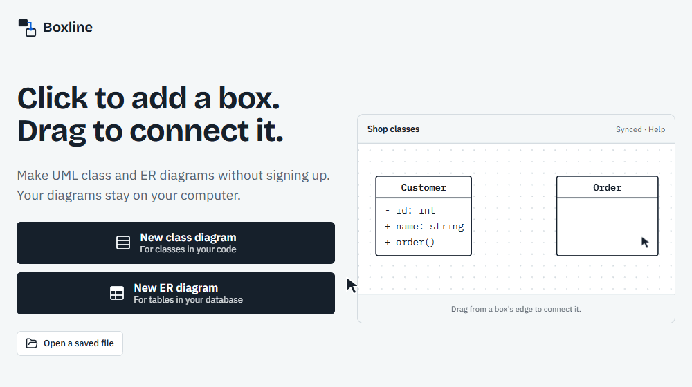
</p>

## About

Many diagram tools make simple work slow. You drag shapes from a panel, double-click to type and memorize shortcuts. Boxline removes those steps, so you click where you want a box and start typing.

## Features

### Start a diagram

Pick a UML class or ER diagram, then choose whether to save it. Each new diagram asks once.

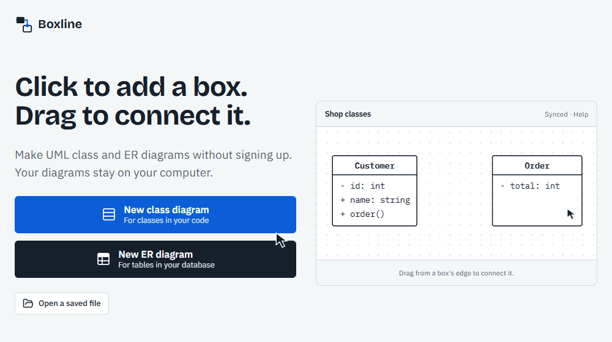

### Add and type

Click an empty spot to add a box with the cursor ready. Press Enter for each row, and on an empty row to finish.

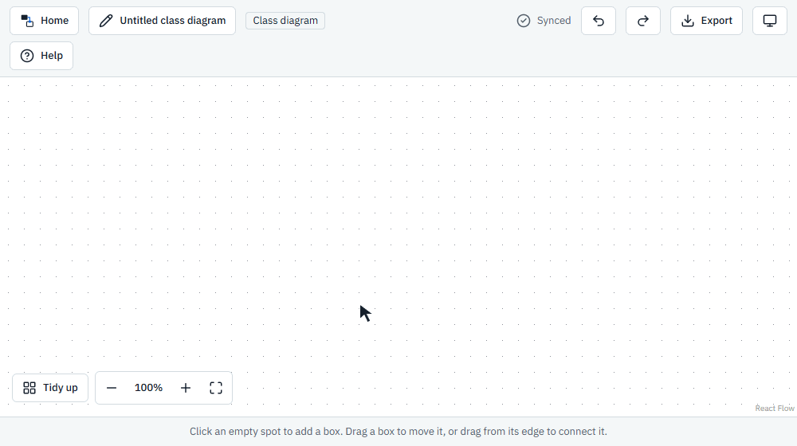

### Move and edit

Drag a box from anywhere to move it, and click any text once to change it. Boxes grow to fit their text, and blank boxes remove themselves.

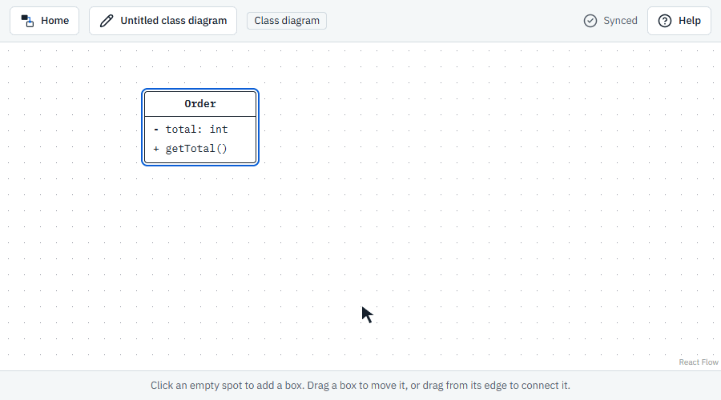

### Connect boxes

Drag from a box's edge to another box, or to an empty spot to make a new connected box. Lines choose their own route and follow when you move a box.

When one box has several lines, each line leaves from its own spot along the side, ordered by where the other box is, so lines don't pile on top of each other. Boxes above or below connect through their top and bottom, and boxes side by side connect through their sides.

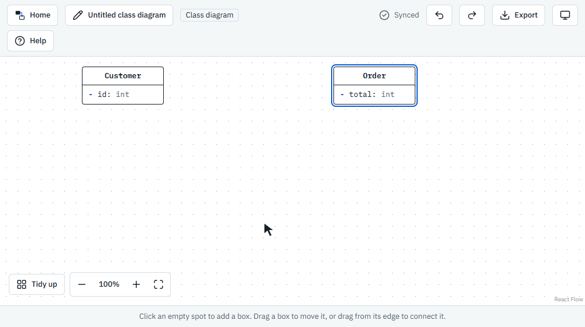

### Line types and labels

Click a line to choose association, inheritance, implementation, dependency, aggregation or composition. Add labels such as `1`, `places` and `0..*`. Type `+`, `-`, `#` or `~` before a row, and rows with `()` move into a methods section.

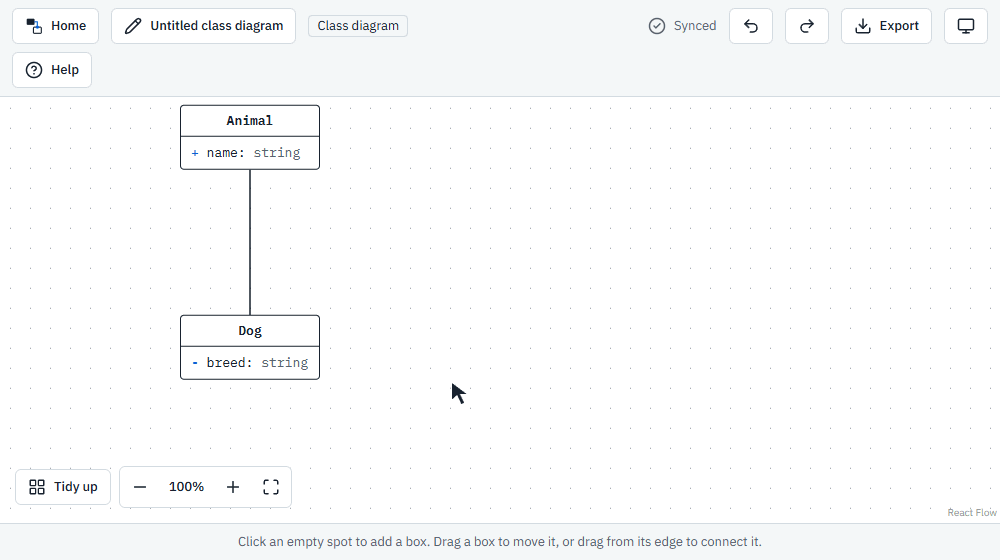

### Keys and relationships

In ER diagrams, type `PK` or `FK` after a column to mark its key. Click a line to choose exactly one, zero or one, one or many, or zero or many at each end.

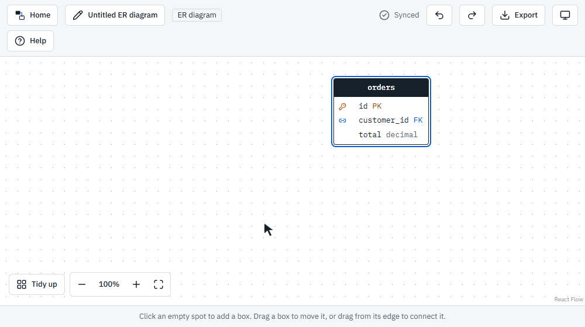

### Auto-sync to your file

After you save, every change syncs to your file about a second after you stop. You can see the file in File Explorer, and a browser backup protects recent changes.

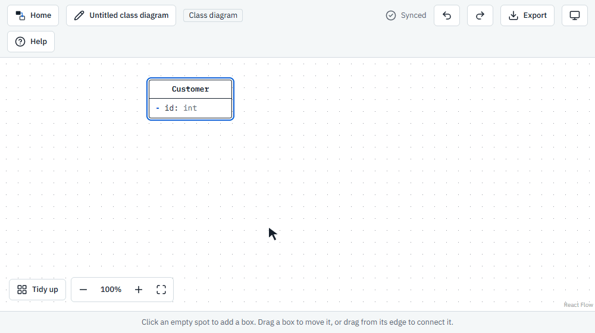

### Come back later

Press **Continue** on the landing page to reopen your last diagram, or **Open a saved file** to open another one.

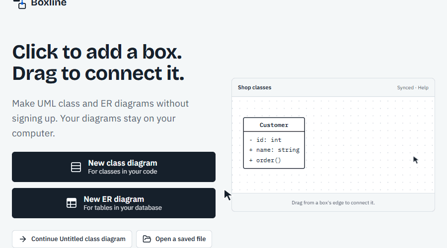

### Rename a diagram

Click the name in the top bar and type a new one. A save window asks you to confirm it, and warns you if that name is already taken.

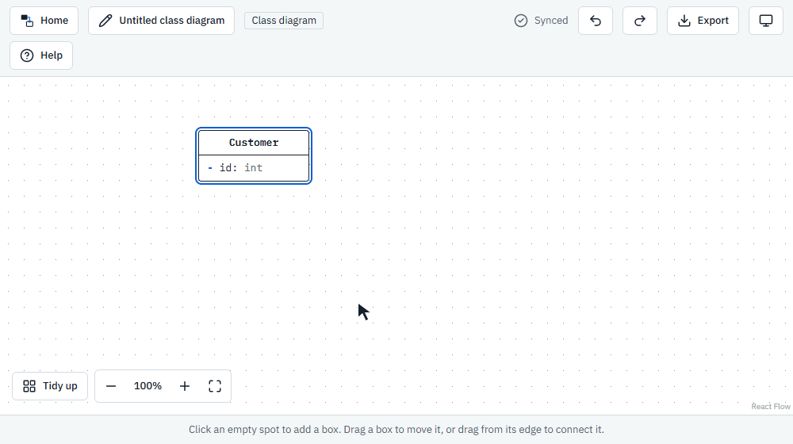

### Export an image

Press **Export** and choose a PNG or SVG image. Exports always use the light theme with a white background, and leave out editing handles.

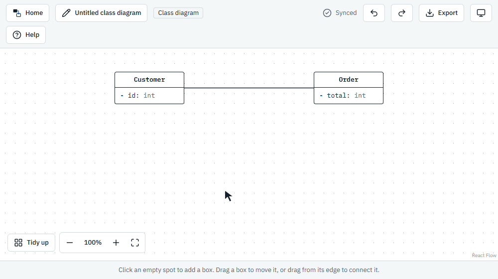

### Undo, align and tidy

Press **Ctrl+Z** to undo and **Ctrl+Y** to redo, or use the buttons in the top bar. Boxes snap into line as you drag them, and the zoom bar shows the zoom level and fits the diagram to the screen.

**Tidy up** arranges the whole diagram in one click, with even spacing between layers:

- Parent classes go above their children for inheritance and implementation.
- For other lines, the box you drew from goes above the box you drew to, so a class with many relationships sits on top like a tree.
- In ER diagrams, the table you drew from goes above the table you drew to.

You can undo a tidy-up with **Ctrl+Z**.

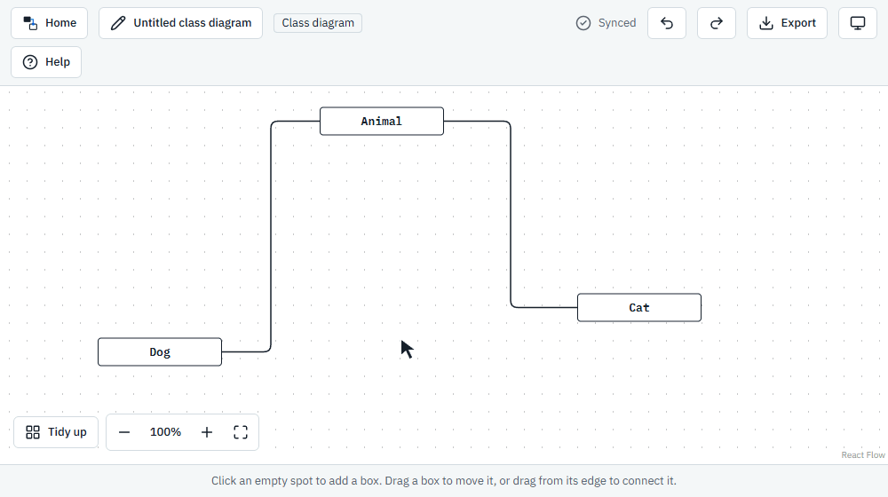

### Also included

- **Built-in help:** a short guide appears before your first diagram, and the **Help** button reopens it at any time.
- **Outside changes:** Boxline reloads a file that changes elsewhere, and asks which version to keep if you've changed it too.
- **Light and dark themes:** the theme follows your system setting, or choose light or dark with the theme button.
- **Private by design:** there's no account, database or backend.

> [!IMPORTANT]
> Auto-sync needs a browser with file access, such as Chrome or Edge. Other browsers can draw diagrams but can't save them yet.

## Set up locally

### Requirements

- [Node.js](https://nodejs.org) 20.9 or newer
- npm, which comes with Node.js
- [Git](https://git-scm.com)
- Chrome or Edge, for auto-sync

### Install and run

```bash
git clone https://github.com/FlemingJohn/boxline.git
cd boxline
npm install
npm run dev
```

Open [http://localhost:3000](http://localhost:3000) in your browser.

### Build for production

```bash
npm run build
npx serve out
```

The build creates a static site in the `out` folder, and `serve` prints the local address to open. The site doesn't need a server of its own, so you can host that folder on any static hosting service.

### Available scripts

| Command | What it does |
|---|---|
| `npm run dev` | Starts the development server |
| `npm run build` | Builds the static site into `out` |
| `npm run lint` | Checks the code with ESLint |

## Contributing

Bug reports, ideas and pull requests are welcome.

1. Fork the repository and create a branch from `main`.
2. Make your change and try it in the browser.
3. Run `npm run lint` and `npm run build`.
4. Open a pull request that explains what changed and why.

Please follow the project's code style:

- Keep each type, component and hook in its own file, named after what it holds.
- Use plain, descriptive names with no abbreviations.
- Don't add code comments. Clear names should explain the code.
- Don't use inline CSS. Use CSS Modules and the design tokens in `src/styles/theme.css`.
- Keep each commit to one file, with a subject line such as `feat: add the item type`.

## Privacy

Boxline has no accounts, database or API routes, and it doesn't collect your diagrams. Your diagrams stay in the files you choose, with temporary backups in your browser. The build downloads its fonts from Google Fonts and includes them in the site, so people using Boxline don't contact Google for them.

## Built with

- [Next.js](https://nextjs.org)
- [React](https://react.dev)
- [TypeScript](https://www.typescriptlang.org)
- [React Flow](https://reactflow.dev)
- [Lucide](https://lucide.dev)
- [idb-keyval](https://github.com/jakearchibald/idb-keyval)
- [html-to-image](https://github.com/bubkoo/html-to-image)
- [dagre](https://github.com/dagrejs/dagre)

## License

Boxline is released under the [MIT License](LICENSE).
